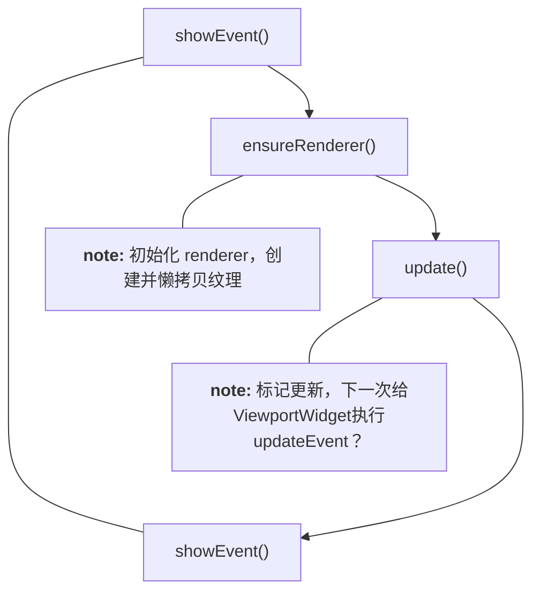
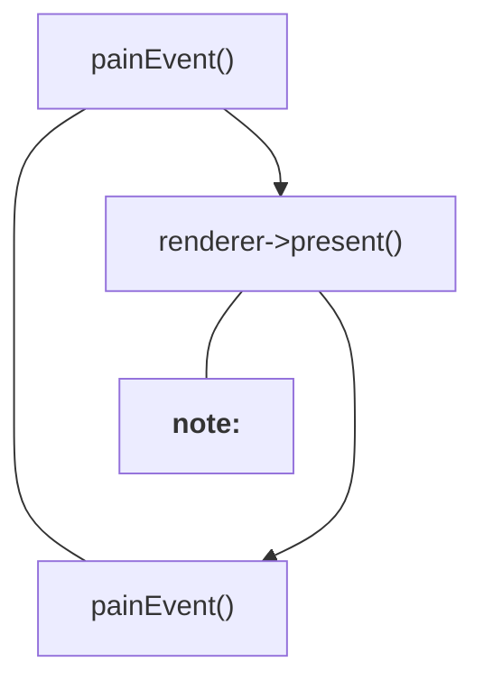
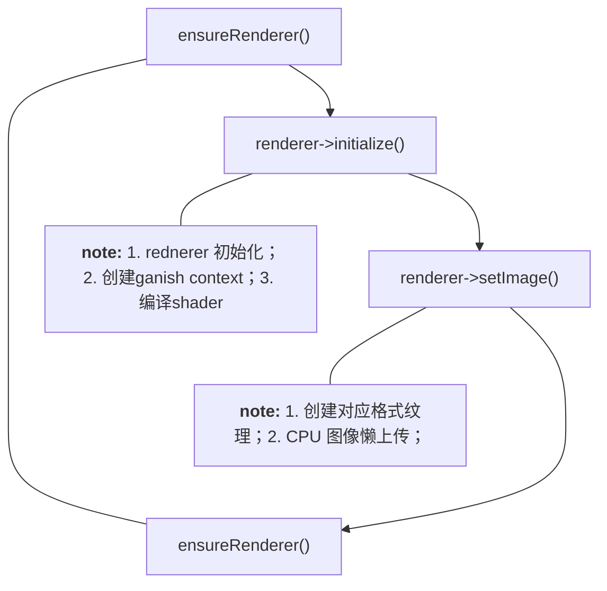
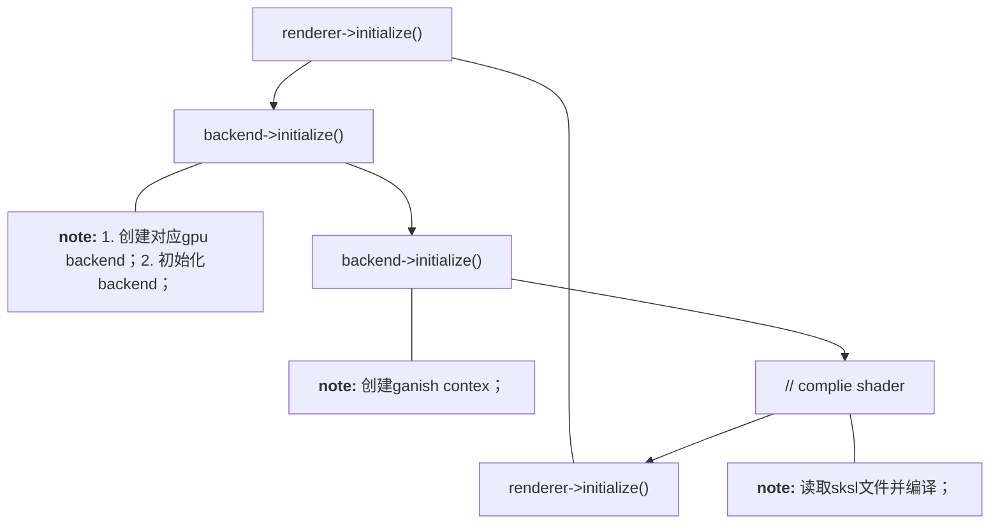
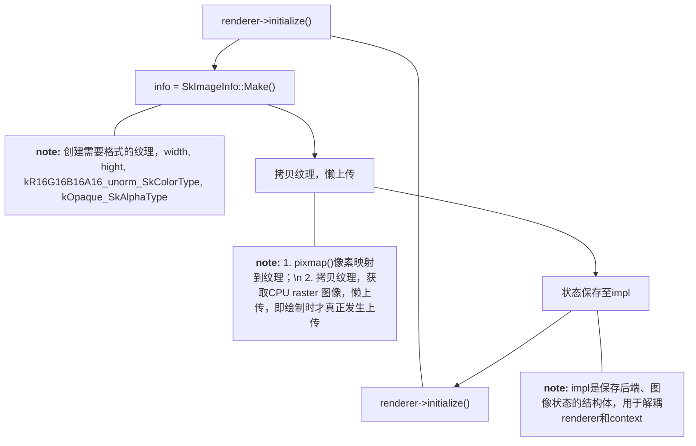
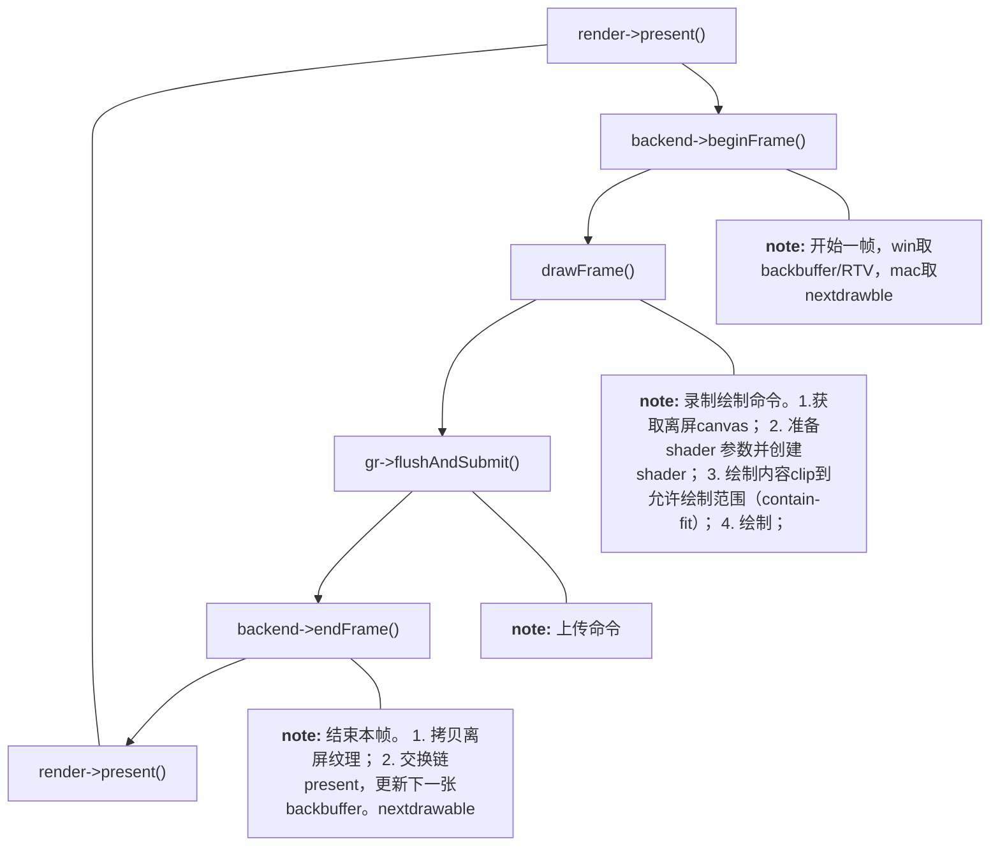

# Pipeline In Mini Insight

## 1. 2个与渲染相关的 Entrance

### 1.1 初始化Renderer 和 Image 信息

> Entrance： `ViewportWidget::showEvent()`



### 1.2 绘制



## `ensureRenderer` 的初始化操作
`src\app\ViewportWidget.cpp, ViewportWidget::ensureRenderer()`



### `renderer->initialize()`



### `renderer->setImage()`



**notes**
- ① 为什么用 RasterFromPixmapCopy（拷贝）而不是 RasterFromPixmap（不拷贝）
    不拷贝版本要求 rgba16 内存在 SkImage 生命周期内一直有效——耦合 app 的 m_image；
    拷贝版本立刻复制 32 MB，SkImage 自持内存，m_image 之后释放也不影响绘制；
    代价是一次 CPU 拷贝（约 32 MB，一次性，可接受）.
- ② GPU 纹理什么时候创建/上传？ 
    RasterFromPixmapCopy 得到的是 CPU raster 图像，不是 GPU 纹理。第一次 drawFrame() 里：
    ``` cpp
    sk_sp<SkShader> imageShader = m_impl->image->makeShader(...);   // 引用 raster 图像
    ... image.eval(...) ...                                        // shader 采样
    m_impl->gr->flushAndSubmit();                                  // Ganesh 在绘制时把 raster 图像上传成 GPU 纹理
    ```
    Ganesh 会在首次使用时把 CPU 图像上传成 GPU 纹理并缓存（GrDirectContext 内部按图像唯一性缓存），后续帧直接复用。所以是懒上传（lazy upload）。
    - 懒上传
        懒上传（lazy upload / deferred instantiation）：创建一个 SkImage 时，Skia 只拿到"CPU 像素 + 格式描述"，还不存在 GPU 纹理。直到某次 GPU 绘制真的需要采样这张图、并且这帧命令被提交（flush）时，Ganesh 才：

        - 创建 GPU 纹理；
        - 把 CPU 像素上传进去；
        - 把纹理放进 GrDirectContext 的资源缓存。
        如果这张图从来没被画出来（窗口没显示、被裁剪、只创建没使用），就一次都不会上传。

        > 所以"懒"指的是：上传时机推迟到"真正要用"的那一刻，而不是"创建图像对象"或"调用 setImage"的那一刻。
    - 缓存复用
        静态图使用同一个 SkImage 对象，首次上传一次，之后复用；
        视频每帧更新同一张 GPU 纹理，复用同一个纹理句柄，每帧只更新内容（仍是 CPU→GPU 带宽，但不重新分配/注册缓存）
        > 视频每帧内容都变，必须有"每帧的数据搬运"。但可以避免"每帧新建对象 + 重新分配纹理"的额外开销。
    - 视频链路的三种可选做法（P2 设计）
        | 方案 | 做法 | 优点 | 缺点 |
        | --- | --- | --- | --- |
        | A. 每帧新 SkImage| 解码 → RasterFromPixmapCopy → draw | 实现最简单 | 每帧新纹理+上传+缓存 churn，最慢 |
        | B. 持久纹理更新 |	创建一次 GPU 纹理；每帧 updateBackendTexture 或 writePixels 更新 |	无分配、缓存稳定 |	需要管理纹理句柄/同步 |
        | C. GPU 上直接画 |	解码帧包成 GPU 纹理（或 YUV pixmaps），画到持久 SkSurface |	最低带宽（YUV 不用转 RGBA） |	需要 YUV/色彩空间处理（正好是 P2/P3 的学习内容） |

## `paintEvent()` 的渲染操作

`src\app\ViewportWidget.cpp, ViewportWidget::paintEvent()`
> 重写qt的`paintEvent()`，直接调用`render->present()`。

### `render->present()`


**notes**
- flushAndSubmit() 确实不"执行"命令，但它也不只是"记录命令列表"：Ganesh 在这一次调用里完成了"资源实例化 + CPU 侧上传准备 + 命令录制 + 提交"，GPU 执行是 submit 之后异步发生的。
| 阶段 | 发生时间 | CPU 做什么 | GPU 做什么 |
|---|---|---|---|
| ① Canvas 录制 | `drawRect` 等调用时 | 记录到 `SkRecord`（还不存在 GPU 命令） | 无 |
| ② **flush** | `flushAndSubmit()` 前半段 | 把 canvas ops 转成 GrOps；准备（onPrepare）；**首次用到图片时：实例化 lazy proxy → 创建 GPU 纹理对象 → 分配 upload/staging buffer → `memcpy` 像素 → 录制"buffer→texture"拷贝命令** | 无（还没提交） |
| ③ **submit** | `flushAndSubmit()` 后半段 | 把后端命令缓冲区提交：D3D12 `ExecuteCommandLists` / Metal `commit` | **真正执行**：GPU 执行 copy/upload、draw |
| ④ 异步完成 | submit 返回之后 | 可以继续下一帧 | GPU 在后台跑；默认**不等待** |
所以准确说法是：

纹理上传的"触发与 CPU 侧工作"发生在 flush；GPU 侧的 copy 执行发生在 submit 之后、异步完成。

#### 