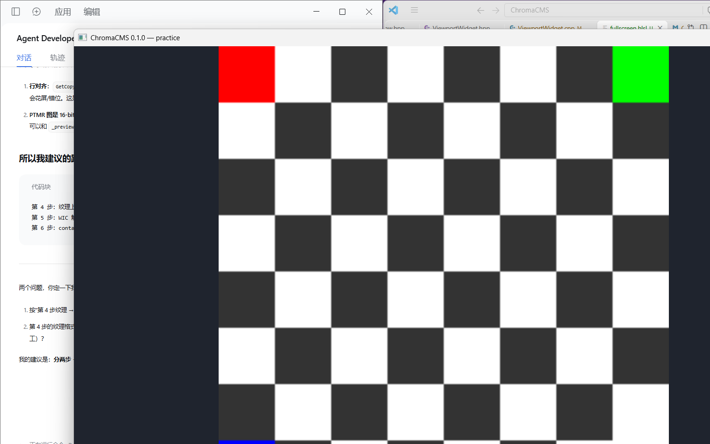
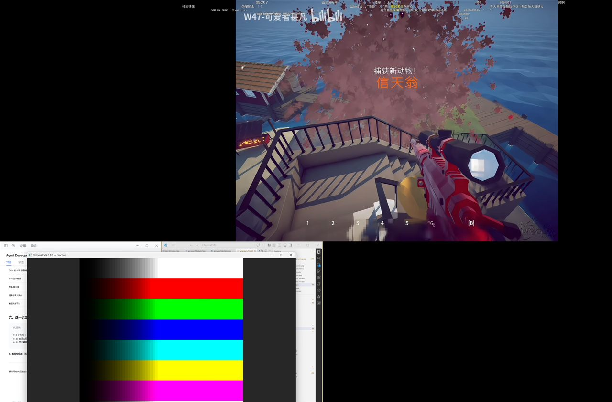

# ChromaCMS · 交接文档（handoff）

> 这套文档的用途：**让 macOS 上的 AI 协作 agent 能无缝接续 Windows 侧已经建立的协作方式和进度**，
> 和用户一起完成 Metal 渲染器，并最终让 D3D12 / Metal 双平台共用同一套色彩管线。

## 阅读顺序

| # | 文件 | 一句话 |
|---|---|---|
| 1 | [`01-project-state.md`](01-project-state.md) | 现在做到哪了、代码地图、环境、验证证据 |
| 2 | [`02-collaboration-protocol.md`](02-collaboration-protocol.md) | **怎么和用户配合**（分工、交付格式、验证配方） |
| 3 | [`03-metal-plan.md`](03-metal-plan.md) | Metal 移植方案：D3D12→Metal 映射、MSL 着色器、路线图 M1–M5 |
| 4 | [`04-dual-platform.md`](04-dual-platform.md) | 双平台架构：渲染器工厂、CMake 条件、一致性测试 |
| 5 | [`05-macos-setup.md`](05-macos-setup.md) | macOS 环境搭建、构建、截图、排错 |
| 6 | [`06-bootstrap-prompt.md`](06-bootstrap-prompt.md) | 可直接粘贴给新 agent 的启动提示词 |

## 当前进度（截至 `practice` @ `da89fd6`）

```
Windows / D3D12（用户手写，agent 指导）
  ✅ 1  CMake + Qt 窗口 + 原生表面
  ✅ 2  设备 / 队列 / 交换链 / RTV / fence / 清屏
  ✅ 3  根签名 + PSO + 全屏三角形
  ✅ 4  纹理上传 + SRV + 采样
  ✅ 5  FFmpeg 解码 PNG → RGBA16 → 上屏
  ✅ 6.1 色彩管理（单 pass）：PQ EOTF → 2020→XYZ→709 线性 → scRGB（16F 输出，无 OETF）
  ⬜ 6.2 根常量传参（outputScale 已跑通）/ 色调映射
  ⬜ 6.3 HDR 输出路径 + 跨屏自适应

macOS / Metal
  ⬜ M1 设备 + CAMetalLayer + 清屏      ← 下一步
  ⬜ M2 全屏三角形（MSL 运行时编译）
  ⬜ M3 纹理上传 + 采样
  ⬜ M4 色彩管线（与 Windows 数学完全一致）
  ⬜ M5 双平台一致性验证
```

## 两张"标准答案"截图

改造 Metal 时，用它们对照输出是否正确：

- 纹理 / 采样阶段（棋盘格 + 四角标记）：
  
- 色彩管线阶段（PQ 解码 + scRGB 输出）：
  

## 三条不可协商的原则

1. **用户写实现代码**（`.cpp/.hpp/.mm/.hlsl/.metal`），agent 写 CMake、建空文件、给逐处改法。
2. **交付前先在 `temp_and_scratch/` 副本里验证**（配置→构建→运行→截图），不要动用户工作区。
3. **不自动提交**；用户说 commit 才提交，且提交前构建必须绿。

## 给新 agent 的第一句话

把 [`06-bootstrap-prompt.md`](06-bootstrap-prompt.md) 里的整段内容粘贴给 macOS 上的 agent 即可。
