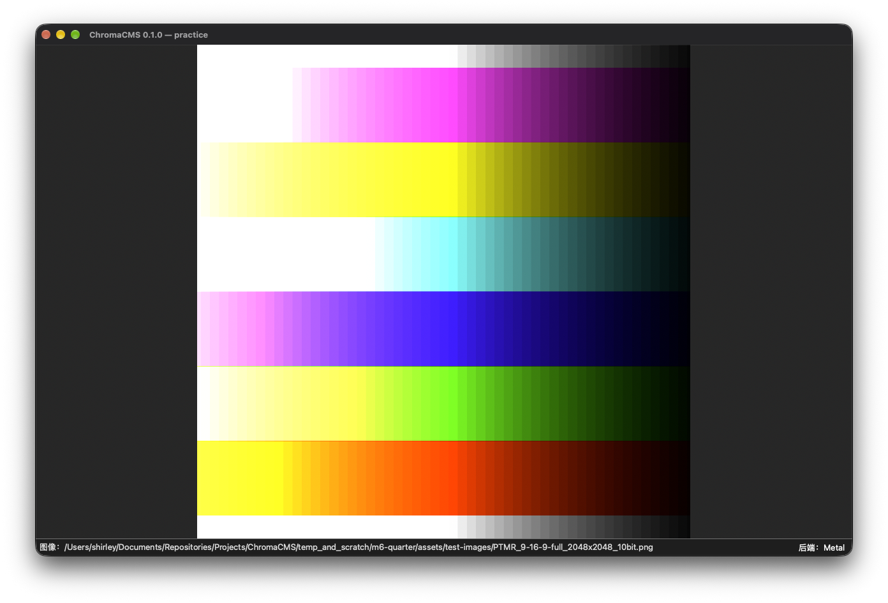

# ChromaCMS · 交接文档（handoff）

> 这套文档的用途：**早期 Windows / macOS 开发与重构的交接记录**。
>
> **2026-11-13 方向重置**：仓库新定位是"色彩管理学习 + 工程实践"（完整链路、多格式、
> CPU oracle、三级测试、双视图对照）。**方向与阶段以 [`../ROADMAP.md`](../ROADMAP.md) 为准**；
> 学习手册见 [`../color/00-index.md`](../color/00-index.md)，测试手册见
> [`../testing/00-index.md`](../testing/00-index.md)，协作规则见 [`../../AGENTS.md`](../../AGENTS.md)。
> 本目录的 `01`–`10` 保留为历史记录与技术参考，**不再是方向来源**。

## 阅读顺序

| # | 文件 | 一句话 |
|---|---|---|
| 1 | [`01-project-state.md`](01-project-state.md) | 现在做到哪了、代码地图、环境、验证证据 |
| 2 | [`02-collaboration-protocol.md`](02-collaboration-protocol.md) | **怎么和用户配合**（分工、交付格式、验证配方） |
| 3 | [`03-metal-plan.md`](03-metal-plan.md) | Metal 移植方案：D3D12→Metal 映射、MSL 着色器、路线图 M1–M5 |
| 4 | [`04-dual-platform.md`](04-dual-platform.md) | 双平台架构：渲染器工厂、CMake 条件、一致性测试 |
| 5 | [`05-macos-setup.md`](05-macos-setup.md) | macOS 环境搭建、构建、截图、排错 |
| 6 | [`06-bootstrap-prompt.md`](06-bootstrap-prompt.md) | 启动提示词（历史；Mac 用 `09` §6 的新版） |
| 7 | [`07-windows-interaction.md`](07-windows-interaction.md) | Windows 交互适配（✅ 已完成，保留作原理参考） |
| 8 | [`08-current-progress.md`](08-current-progress.md) | 历史进度：Windows 交互 + 渲染层重构 + MetalContext 拆分方案（已完成，见 `822b976`） |
| 9 | [`09-skia-backend.md`](09-skia-backend.md) | Skia 第三后端的实现与 mac 验证记录 |
| 10 | [`10-skia-refactor-cmake.md`](10-skia-refactor-cmake.md) | 历史记录：SkiaGpuBackend 重构 + CMakeLists 分层规范（规范仍有效） |

## 当前进度（本次 Skia 重构提交）

```
Windows / D3D12（用户手写，agent 指导）
  ✅ 1  CMake + Qt 窗口 + 原生表面
  ✅ 2  设备 / 队列 / 交换链 / RTV / fence / 清屏
  ✅ 3  根签名 + PSO + 全屏三角形
  ✅ 4  纹理上传 + SRV + 采样
  ✅ 5  FFmpeg 解码 PNG → RGBA16 → 上屏
  ✅ 6.1 色彩管理（单 pass）：PQ EOTF → 2020→XYZ→709 线性 → scRGB（16F 输出，无 OETF）
  ✅ 6.2 根常量传参（outputScale = 0.8）
  ✅ 7  交互：A/D 90° 旋转、Q/E 缩放、R 复位（8×float 常量 + 2×2 矩阵 UV）   [42518f8]
  ✅ 8  渲染层重构：新增 gfx/d3d12/D3D12Context（设备/交换链/同步/帧生命周期），
        D3D12Renderer 只留绘制；后端按 render/<api>/ 分目录              [1575472]
  ✅ 9  Skia 第三后端（Windows）：SkiaRenderer（Ganesh D3D12）+ shaders/fullscreen.sksl
        （PQ 色彩链 + 交互），与手写 D3D12 后端逐像素一致                [ff89ba9]
  ⬜ 6.3 HDR / 色调映射 / 跨屏自适应

macOS / Metal
  ✅ M1 设备 + CAMetalLayer + 清屏
  ✅ M2 全屏三角形（MSL 运行时编译）
  ✅ M3 纹理上传 + 采样
  ✅ M4 色彩管线：PQ → 2020→XYZ → 2020→Display-P3 线性
  ✅ 交互：A/D 90° 旋转、Q/E 缩放、R 复位（矩阵 UV）
  ✅ M4.6 MetalContext 拆分（与 gfx::D3D12Context 对偶）
  ✅ MetalRenderer 拆分为 .cpp/.mm + MetalRendererImpl.hpp
  ⬜ M5 双平台一致性验证（CPU ColorMath 基础测试已过，CSV 断言待补）

第三后端 Skia（SkiaGpuBackend）
  ✅ Windows：SkiaRenderer + SkiaGpuBackendD3D12（Ganesh D3D12）
  ✅ macOS：SkiaRenderer + SkiaGpuBackendMetal（Ganesh Metal）
  ✅ CMake 分层：每个构建目录一个 CMakeLists；Skia 为可选独立 target
  ⬜ Windows `SkiaGpuBackendD3D12.cpp` 实机编译/运行（下一步）
  ⬜ M5 CSV nits 断言
```

**重构后的目录约定**：`src/gfx/<api>/` 放该平台的原生上下文（设备/交换链/同步），
`src/render/<api>/` 放后端绘制实现；详见 `08` §3。

## 验收截图

改造 Metal 时，用它们对照输出是否正确：

- 纹理 / 采样阶段（棋盘格 + 四角标记）：
  
- 色彩管线阶段（Windows：PQ 解码 + scRGB 输出）：
  
- macOS 90° 交互（矩阵 UV）：
  
- macOS 180° + 1.21× 缩放：
  

## 协作规则（2026-11-13 起）

**当前规则以 [`../../AGENTS.md`](../../AGENTS.md) 为准**：实现代码由 agent 编写、agent 本地 commit、
用户 push、禁止未经授权的远程写操作、每阶段双平台验收。

以下是 2026-11-13 之前的历史原则（保留作背景）：

1. 用户写实现代码（`.cpp/.hpp/.mm/.hlsl/.metal`），agent 写 CMake、建空文件、给逐处改法。
2. 交付前先在 `temp_and_scratch/` 副本里验证。
3. 不自动提交。

## 给新 agent 的第一句话

先读 [`../../AGENTS.md`](../../AGENTS.md) 和 [`../ROADMAP.md`](../ROADMAP.md)；
需要历史代码地图/踩坑时，再按本目录索引翻 `01`–`10`。
当前阶段与验收标准只在 `ROADMAP.md` 维护。
