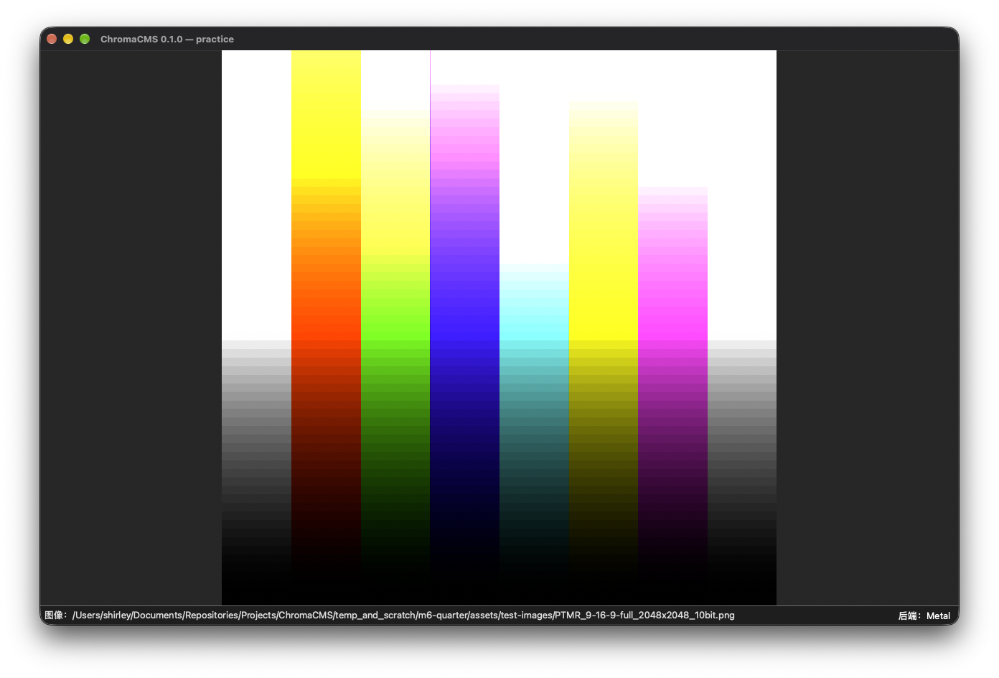

# ChromaCMS · 交接文档（handoff）

> 这套文档的用途：**让 Windows / macOS 两侧的 AI 协作 agent 能互相接续进度**。
> Windows 侧已完成交互适配（`42518f8`）与渲染层重构（`gfx` 上下文层 + 后端分目录）；
> 现在转到 macOS，做对应的 `MetalContext` 拆分（见 **`08`**）。

## 阅读顺序

| # | 文件 | 一句话 |
|---|---|---|
| 1 | [`01-project-state.md`](01-project-state.md) | 现在做到哪了、代码地图、环境、验证证据 |
| 2 | [`02-collaboration-protocol.md`](02-collaboration-protocol.md) | **怎么和用户配合**（分工、交付格式、验证配方） |
| 3 | [`03-metal-plan.md`](03-metal-plan.md) | Metal 移植方案：D3D12→Metal 映射、MSL 着色器、路线图 M1–M5 |
| 4 | [`04-dual-platform.md`](04-dual-platform.md) | 双平台架构：渲染器工厂、CMake 条件、一致性测试 |
| 5 | [`05-macos-setup.md`](05-macos-setup.md) | macOS 环境搭建、构建、截图、排错 |
| 6 | [`06-bootstrap-prompt.md`](06-bootstrap-prompt.md) | 启动提示词（历史；Mac 用 `08` §11 的新版） |
| 7 | [`07-windows-interaction.md`](07-windows-interaction.md) | Windows 交互适配（✅ 已完成，保留作原理参考） |
| 8 | [`08-current-progress.md`](08-current-progress.md) | **当前进度**：Windows 交互落地 + 渲染层重构 + **macOS 的 MetalContext 拆分方案** |

## 当前进度（`practice` @ `42518f8` + 本次重构提交）

```
Windows / D3D12（用户手写，agent 指导）
  ✅ 1  CMake + Qt 窗口 + 原生表面
  ✅ 2  设备 / 队列 / 交换链 / RTV / fence / 清屏
  ✅ 3  根签名 + PSO + 全屏三角形
  ✅ 4  纹理上传 + SRV + 采样
  ✅ 5  FFmpeg 解码 PNG → RGBA16 → 上屏
  ✅ 6.1 色彩管理（单 pass）：PQ EOTF → 2020→XYZ→709 线性 → scRGB（16F 输出，无 OETF）
  ✅ 6.2 根常量传参（outputScale = 0.8）
  ✅ 7  交互：A/D 90° 旋转、Q/E 缩放、R 复位（8×float 常量 + 2×2 矩阵 UV）   [42518f8]
  ✅ 8  渲染层重构：新增 gfx/d3d12/D3D12Context（设备/交换链/同步/帧生命周期），
        D3D12Renderer 只留绘制；后端按 render/<api>/ 分目录              [本次提交]
  ⬜ 6.3 HDR / 色调映射 / 跨屏自适应

macOS / Metal
  ✅ M1 设备 + CAMetalLayer + 清屏
  ✅ M2 全屏三角形（MSL 运行时编译）
  ✅ M3 纹理上传 + 采样
  ✅ M4 色彩管线：PQ → 2020→XYZ → 2020→Display-P3 线性
  ✅ 交互：A/D 90° 旋转、Q/E 缩放、R 复位（矩阵 UV）
  ⬜ M4.6 MetalContext 拆分（与 gfx::D3D12Context 对偶）   ← 下一步，见 08 §6
  ⬜ M5 双平台一致性验证（CPU ColorMath + CSV 断言）

第三后端（准备中）
  ⬜ SkiaRenderer（Ganesh）：cmake/FindSkia.cmake + docs/third-party/skia.md 已有，
     尚未接进构建图
```

**重构后的目录约定**：`src/gfx/<api>/` 放该平台的原生上下文（设备/交换链/同步），
`src/render/<api>/` 放后端绘制实现；详见 `08` §3。

## 验收截图

改造 Metal 时，用它们对照输出是否正确：

- 纹理 / 采样阶段（棋盘格 + 四角标记）：
  
- 色彩管线阶段（Windows：PQ 解码 + scRGB 输出）：
  
- macOS 90° 交互（矩阵 UV）：
  
- macOS 180° + 1.21× 缩放：
  

## 三条不可协商的原则

1. **用户写实现代码**（`.cpp/.hpp/.mm/.hlsl/.metal`），agent 写 CMake、建空文件、给逐处改法。
2. **交付前先在 `temp_and_scratch/` 副本里验证**（配置→构建→运行→截图），不要动用户工作区。
3. **不自动提交**；用户说 commit 才提交，且提交前构建必须绿。

## 给新 agent 的第一句话

Mac：把 [`08-current-progress.md`](08-current-progress.md) 的 §11 启动提示词粘贴给 macOS 上的 agent
（它自带"先读哪些文件 + 第一个任务 = MetalContext 拆分"）。

Windows：`AGENTS.md` + `01` 即可；如果要继续改渲染器，再读 `08` §3（重构后的分层）。
